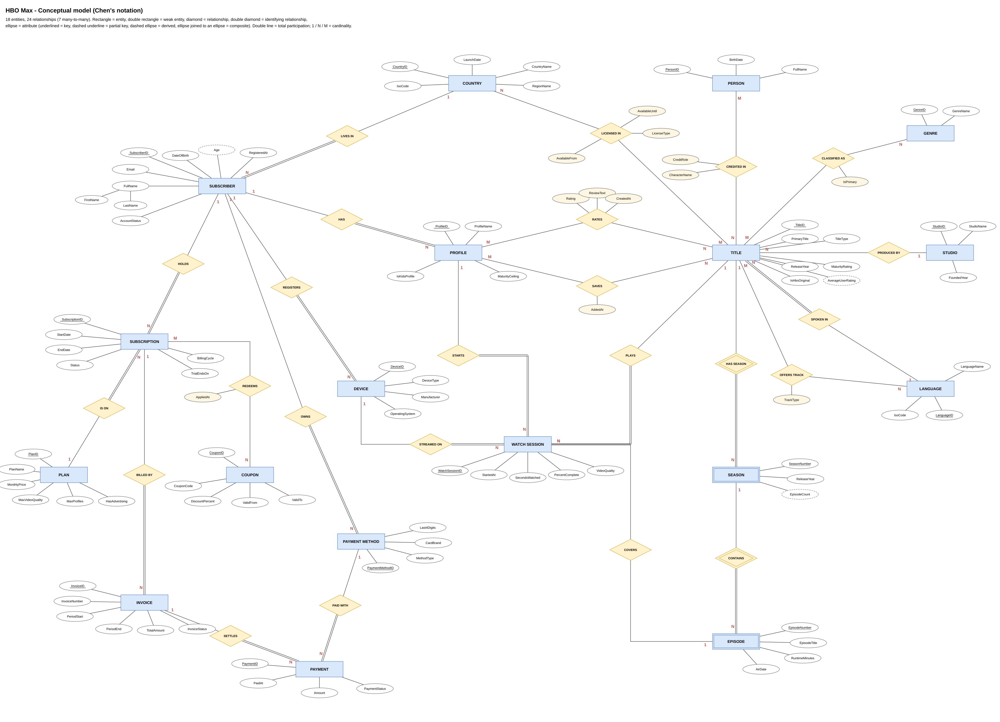
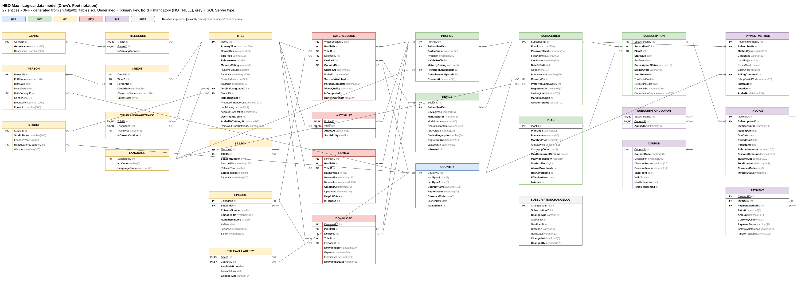
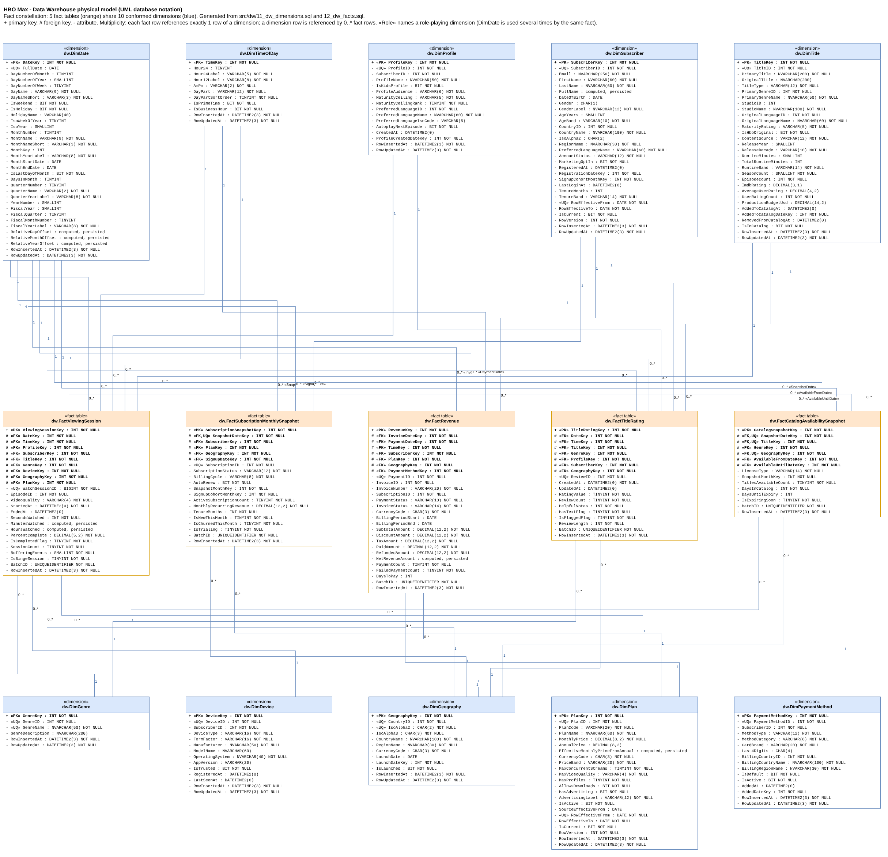

# HBO Max: data model, data warehouse and BI report

| | |
|---|---|
| **Student(s)** | `Деян Дудунски`, faculty number `2601322046` · `Валентин Котов`, faculty number `2601322045` |
| **Course** | Software Modeling and Analysis, Plovdiv University |
| **Project** | HBO Max (Max), a subscription video-streaming platform |

## Short description

This project models HBO Max from start to finish:

1. **Conceptual model** in Chen notation (18 entities, 24 relationships), and a **logical model** in Crow's Foot notation, with 27 entities and 229 attributes.
2. **`HBOMaxOLTP`**: a 3NF SQL Server database covering accounts, plans, subscriptions, profiles and devices; the content catalogue (titles, seasons, episodes, genres, people, licensing); playback and engagement (watch sessions, watchlists, reviews, downloads); and billing (invoices, payments, coupons). It includes 7 stored procedures, 7 functions, 7 triggers, 4 views and generated demo data.
3. **`HBOMaxDW`**: a Kimball data warehouse (fact constellation) with **5 fact tables and 10 dimensions**. SCD Type 2 is applied to subscriber geography and plan price. The warehouse is loaded by an audited, re-runnable, set-based T-SQL ETL, and seven analytic views sit on top of it.
4. **Power BI report** with 5 pages and 27 visuals, built on the analytic views and shipped as a Power BI project (`src/bi/HBOMax.pbip`).

## Course requirements: where each one is met

| # | Requirement | Where | Status |
|---|---|---|---|
| 1 | Choose an online platform | HBO Max | ✅ |
| 2 | Conceptual diagram (Chen) | [`docs/diagrams/01-conceptual-chen.drawio`](docs/diagrams/01-conceptual-chen.drawio): 18 entities (2 weak), 24 relationships, 7 M:N | ✅ |
| 2 | Logical diagram (Crow's Foot): ≥ 8 entities, ≥ 30 attributes, ≥ 1 many-to-many | [`docs/diagrams/02-logical-crowsfoot.drawio`](docs/diagrams/02-logical-crowsfoot.drawio): **27** entities, **229** attributes, **5** M:N (TitleGenre, Credit, TitleLanguageTrack, Watchlist, SubscriptionCoupon) | ✅ |
| 3 | SQL Server database built from the diagrams | `src/oltp/01–07` (+ 4 views in `07_views.sql`) | ✅ |
| 3 | ≥ 2 stored procedures, ≥ 2 functions, ≥ 2 triggers | `05_stored_procedures.sql` (**7**), `04_functions.sql` (**7**), `06_triggers.sql` (**7**) | ✅ |
| 3 | Populate the database | `src/oltp/08_seed_data.sql` | ✅ |
| 4 | Data Warehouse diagram (UML): ≥ 3 facts, ≥ 6 dimensions | [`docs/diagrams/03-dw-physical-uml.drawio`](docs/diagrams/03-dw-physical-uml.drawio): **5** facts, **10** dimensions; constellation page plus one star per fact | ✅ |
| 5 | Power BI report, ≥ 4 visualizations | [`src/bi/HBOMax.pbip`](src/bi/HBOMax.pbip): **27** visuals on 5 pages, over the 7 analytic views; guide in [`docs/POWER_BI_REPORT.md`](docs/POWER_BI_REPORT.md) | ✅ |
| 6 | README with faculty number, name, description, install/run | this file | ⏳ fill in the faculty number(s) |

**Beyond the requirements (extra credit):**
- A complete ETL framework with an audit log, incremental watermarks, staging tables and SCD Type 2.
- A load report with source-to-target reconciliation and data-quality counts (`16_run_full_load.sql`).
- Seven analytic views.
- A DAX measure library with time intelligence (`src/bi/measures.dax`).
- A static SQL checker (`tools/check_sql_consistency.py`).
- Diagrams generated from the DDL (`tools/generate_diagrams.py`) and the conceptual model generated from code (`tools/generate_chen_diagram.py`).
- A deterministic, re-runnable seed: the same data on every run, with a realistic subscription history (trials, plan changes, cancellations, re-subscriptions) written by the audit trigger.
- An architecture document with design decisions ([`docs/ARCHITECTURE.md`](docs/ARCHITECTURE.md)).

## Diagrams

**Conceptual model (Chen)**



| Logical model (Crow's Foot) | DW constellation (UML) |
|---|---|
|  |  |

There is also a star diagram per fact table: [viewing](docs/diagrams/png/03.1-star-viewing-session.png) · [subscription snapshot](docs/diagrams/png/03.2-star-subscription-snapshot.png) · [revenue](docs/diagrams/png/03.3-star-revenue.png) · [title rating](docs/diagrams/png/03.4-star-title-rating.png) · [catalogue snapshot](docs/diagrams/png/03.5-star-catalog-snapshot.png) · [ETL schema](docs/diagrams/png/03.6-etl-schema.png).

Open the `.drawio` files in [diagrams.net](https://app.diagrams.net), the draw.io desktop app, or the VS Code *Draw.io Integration* extension.

---

## Installation and running

### Requirements
- **Microsoft SQL Server 2019 or newer.** Developer and Express editions both work, as does Azure SQL Managed Instance. **Both databases must be on the same instance**, because the ETL reads `HBOMaxOLTP` with three-part names.
- SSMS, Azure Data Studio or `sqlcmd`.
- **Power BI Desktop** (Windows) for the report.
- Python 3.9+ for the tools. This is optional and needs only the standard library.

### 1. Create and populate the transactional database

Run the scripts **in order**, as a login with `CREATE DATABASE` permission:

```
src/oltp/01_create_database.sql      database HBOMaxOLTP + schemas geo, acct, cat, play, bill, audit
src/oltp/02_tables.sql               27 tables, PK/FK/UNIQUE/CHECK
src/oltp/03_indexes.sql
src/oltp/04_functions.sql
src/oltp/05_stored_procedures.sql
src/oltp/06_triggers.sql
src/oltp/07_views.sql
src/oltp/08_seed_data.sql            demo data (deterministic, re-runnable; ~30 seconds)
```

### 2. Build and load the data warehouse

```
src/dw/10_create_dw_database.sql     database HBOMaxDW + schemas dw, etl
src/dw/11_dw_dimensions.sql          10 dimensions (with -1 Unknown members)
src/dw/12_dw_facts.sql               5 facts
src/dw/13_etl_staging.sql            etl.LoadAudit, etl.LoadWatermark, staging tables
src/dw/14_etl_procedures.sql         10 dimension loaders, 5 fact loaders, etl.usp_RunFullLoad
src/dw/15_dw_analytic_views.sql      7 report views
src/dw/16_run_full_load.sql          runs the ETL and prints the load report
```

With `sqlcmd` (Windows PowerShell, integrated security):

```powershell
Get-ChildItem src\oltp\0*.sql, src\dw\1*.sql | Sort-Object Name |
  ForEach-Object { sqlcmd -S localhost -E -b -i $_.FullName; if ($LASTEXITCODE) { throw "failed: $($_.Name)" } }
```

> ⚠️ `01_create_database.sql` and `10_create_dw_database.sql` **drop and recreate** their database. Don't run them against a database whose data you want to keep.

`16_run_full_load.sql` prints five result sets:
1. The audit trail of the run.
2. Row counts per table.
3. A source-to-target reconciliation. Every row should read **OK**.
4. Fact rows attached to an Unknown (`-1`) member, by dimension.
5. A row count for each analytic view.

To refresh the warehouse later with incremental loads only:

```sql
EXEC HBOMaxDW.etl.usp_RunFullLoad;              -- incremental facts, rebuilt snapshots
EXEC HBOMaxDW.etl.usp_RunFullLoad @FullReload = 1;  -- ignore watermarks, rebuild everything
```

### 3. Open the Power BI report

Double-click `src/bi/HBOMax.pbip`. Power BI Desktop opens the model and all five pages; click **Refresh now** in the yellow bar to pull the current data out of `HBOMaxDW`. A `.pbip` project stores the model and the report as text, never a copy of the data, so the report always shows what is in your warehouse today.

If your instance is not `localhost\SQLEXPRESS`, set it once under **Home › Transform data › Edit parameters** — no query needs editing. [`docs/POWER_BI_REPORT.md`](docs/POWER_BI_REPORT.md) walks through the model, every page and the optional finishing touches.

### 4. Tools (optional)

```bash
python tools/check_sql_consistency.py      # static check: every table/column reference resolves
python tools/generate_diagrams.py          # regenerate the logical + DW diagrams from the DDL
python tools/generate_chen_diagram.py      # regenerate the conceptual (Chen) diagram + PNG
```

---

## Repository layout

```
src/
  oltp/   01–08   HBOMaxOLTP: schema, logic, seed data
  dw/     10–16   HBOMaxDW: dimensions, facts, ETL, views, load script
  bi/             HBOMax.pbip     open this with Power BI Desktop
                  HBOMax.SemanticModel/  the model, as TMDL
                  HBOMax.Report/         the report: 5 pages, 27 visuals
                  measures.dax           optional DAX measure library
docs/
  ARCHITECTURE.md       design and decisions
  POWER_BI_REPORT.md    report guide: how to open it, and what is on each page
  diagrams/             01 conceptual (Chen), 02 logical (Crow's Foot), 03 DW (UML), png/ exports
tools/
  check_sql_consistency.py
  generate_diagrams.py
  generate_chen_diagram.py
```

## Submitting

As the course requires, this folder goes into **your fork** of [pkyurkchiev/software-modeling-and-analysis-se-pt](https://github.com/pkyurkchiev/software-modeling-and-analysis-se-pt) under `course-work/Implementations/<faculty-number>-hbo-max/`, with this README at its root.
