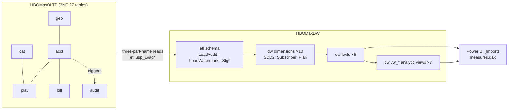

# Architecture: HBO Max OLTP → DW → BI

**Status:** Reflects the code in `src/` as of 2026-10-21.

## 1. Context and goals

This document models a subscription streaming service at two levels:

- **Operational.** The system has to record sign-ups, plan changes, playback, reviews, invoices and payments correctly. The model must reject bad data and keep history intact.
- **Analytical.** The business questions are: How is viewing demand changing by region? What are the top titles? How do revenue and MRR split by plan? What does churn look like by cohort? How does genre engagement vary by time of day? What is the device mix? Do Originals perform differently from licensed titles?

Constraints:
- Everything is T-SQL on one SQL Server 2019+ instance.
- There is no external ETL tool.
- All scripts must be reproducible and safe to re-run.

## 2. High-level design

### 2.1 OLTP: `HBOMaxOLTP`

| Schema | Owns |
|---|---|
| `geo` | Country reference data (ISO codes, region, currency, launch) |
| `acct` | Plan, Subscriber, Subscription, Profile, Device |
| `cat` | Studio, Title, Season, Episode, Genre, Person, Credit, availability, language tracks |
| `play` | WatchSession, Watchlist, Review, Download |
| `bill` | PaymentMethod, Coupon, SubscriptionCoupon, Invoice, Payment |
| `audit` | SubscriptionChangeLog, written by trigger |

**Where the business logic lives:**
- **Constraints** enforce single-row rules such as valid regions, prices and ratings.
- **Triggers** handle rules that span rows: plan profile limits, episodes that must belong to the watched title, derived counters (season episode count, title rating), invoice settlement on payment, and the subscription audit trail.
- **Stored procedures** wrap multi-table business operations in transactions.

**Delete rules are deliberately narrow.** Only true ownership chains cascade, for example Title → Season → Episode. Tables that hold history (playback, invoices, payments) use `NO ACTION`, so analytical history can never be silently removed.

### 2.2 Warehouse: `HBOMaxDW`

**Dimensions.** All 10 are conformed, use an `INT IDENTITY` surrogate key and have a `-1 Unknown` member. The exceptions are `DimDate` (key `yyyymmdd`) and `DimTimeOfDay` (key = hour), which use intelligent keys.

| Dimension | SCD | Notes |
|---|---|---|
| DimSubscriber | **Type 2** on country/geography | Count people by `SubscriberID`, not by key |
| DimPlan | **Type 2** on price/currency | Lets revenue be reported at the price that was in force at the time |
| DimDate, DimTimeOfDay | Generated | Calendar 2019–2027; US holidays; fiscal year starts 1 Oct; ISO weekday independent of `DATEFIRST`/`LANGUAGE` |
| Profile, Title, Genre, Device, Geography, PaymentMethod | Type 1 | Changes are treated as corrections, so restating history is correct |

**Facts.** The grain is declared first in each table's header.

| Fact | Type | Grain |
|---|---|---|
| FactViewingSession | Transaction, incremental | One row per `play.WatchSession` |
| FactRevenue | Transaction, incremental | One row per payment line |
| FactTitleRating | Transaction, incremental | One row per review (profile × title) |
| FactSubscriptionMonthlySnapshot | Periodic snapshot | One row per subscription per month-end |
| FactCatalogAvailabilitySnapshot | Periodic snapshot | One row per title × country × month-end |

### 2.3 ETL framework (`etl` schema)

Every load procedure follows the same contract:

1. `SET NOCOUNT ON; SET XACT_ABORT ON`.
2. The **audit row is written before the transaction opens**. A rollback therefore cannot erase the record that the run happened.
3. `TRY / TRAN / CATCH` handling: roll back, write the error number, line and message to the audit row, then `THROW` so the scheduler still sees the failure.
4. **Idempotent loads.** Dimensions use `MERGE` without `NOT MATCHED BY SOURCE`. Incremental facts use delete-then-insert over a watermark window with a 3-day lookback. Snapshots are fully rebuilt.
5. **Set-based only.** There are no cursors or `WHILE` loops; "pick one row per group" logic uses `OUTER APPLY … TOP (1)`.
6. **No fact row is ever dropped.** A failed dimension lookup falls back to `-1`.

### 2.4 Presentation

- **Analytic views.** Each view in `15_dw_analytic_views.sql` answers one business question and feeds one report visual. The views average non-additive measures and only aggregate semi-additive snapshot measures within a single month. They are not schema-bound, because they use `COUNT(DISTINCT)`, window functions and outer joins, which indexed views cannot contain.
- **Power BI.** The report uses Import mode over the star schema, with the measures in `src/bi/measures.dax`. `DimDate` must be marked as the date table.

---

## 3. Key decisions

### ADR-001: Separate OLTP and DW databases on one instance

**Status:** Accepted

**Context.** Both databases had to run on a single machine with only T-SQL available.

**Options considered:**
- **Reporting views on the OLTP.** Simplest option, but it gives no history and puts analytical load on the transactional system.
- **A separate DW on another server, fed by SSIS or ADF.** The realistic production setup, but it needs infrastructure the project doesn't have.
- **A separate DW on the same instance with T-SQL ETL.** Chosen.

**Trade-off.** Three-part names keep the ETL simple and transactional. The cost is coupling: both databases must live on the same instance. Moving the warehouse to another server would require a linked server or an external ETL tool.

**Consequences.** Setup is easy to reproduce. Production-style scheduling and scaling are not covered.

### ADR-002: SCD Type 2 only on Subscriber geography and Plan price

**Status:** Accepted

**Context.** Revenue and viewing must be attributable to the price and country that applied at the time of the event. Most other attribute changes are corrections.

**Options considered:**
- **Type 1 everywhere.** Simple, but it misattributes revenue after a price change or a subscriber's move.
- **Type 2 everywhere.** Gives full history, but the dimensions grow quickly and analysts must reason about versions on every dimension.
- **Targeted Type 2.** Chosen.

**Trade-off.** History is kept exactly where it changes the numbers. The cost is that subscriber headcounts must use `COUNT(DISTINCT SubscriberID)`, not the surrogate key. The analytic views enforce this rule.

### ADR-003: Re-runnable, set-based ETL with an audit row written first

**Status:** Accepted

**Context.** With no orchestration tool, re-running scripts has to be safe, and failures have to be diagnosable.

**Decision.** Use `MERGE` for dimensions, watermark plus lookback with delete-insert for incremental facts, and full rebuilds for snapshots. Write the audit row outside the transaction, and use `-1` as the fallback for failed lookups.

**Consequences:**
- Any procedure can be run twice and produce the same result.
- Late-arriving source rows within 3 days are picked up.
- Rows that fall back to `-1` must be monitored, which is the job of `16_run_full_load.sql` (result set 4).

### ADR-004: Business rules enforced in the database

**Status:** Accepted

**Context.** There is no application tier in scope, so the database is the only place to enforce invariants.

**Decision.** Use constraints for single-row rules, triggers for rules that span rows and for derived counters, and procedures for multi-step operations.

**Consequences.** The database protects itself against bad data. The costs are hidden write cost from the triggers, and logic that is harder to unit-test than application code.

---

## 4. Data flow: one watch session

1. A client calls `play.usp_RecordWatchSession`.
2. The trigger `trg_WatchSession_ValidateEpisode` checks that the episode belongs to the title, and the row lands in `play.WatchSession`.
3. On the next ETL run, the watermark on `StartedAt` (with a 3-day lookback) selects the row into `etl.StgWatchSession`.
4. `etl.usp_LoadFactViewingSession` resolves the Date, Time, Profile, Subscriber, Title, Genre, Device, Geography and Plan keys, using `-1` if any lookup fails. Subscriber and Plan are point-in-time lookups: they take the SCD2 version valid on the session date. The plan is the one in force that day, found by `etl.utvf_PlanInForce` from `audit.SubscriptionChangeLog`.
5. The row is delete-inserted into `dw.FactViewingSession`.
6. The row is then visible through `dw.vw_ViewingTrendByMonthRegion` and similar views, and through Power BI measures such as `[Total Hours Watched]`.

## 5. Verification

The full build (`01`–`08`, then `10`–`16`) has been run end to end on SQL Server 2022 (Developer edition, Linux container). It takes about a minute on a laptop. The result of that run:

- Every script completes without errors.
- `16_run_full_load.sql` reports **OK** on all eight source-to-target reconciliation checks (row counts, seconds watched, settled and refunded amounts, review count and average rating, invoice allocation).
- No fact row is attached to an Unknown (`-1`) member.
- All seven analytic views return rows.
- A second `EXEC etl.usp_RunFullLoad` (incremental) leaves every fact row count unchanged, so the loads are idempotent.
- Running `08_seed_data.sql` twice produces identical data (compared with `CHECKSUM_AGG` over the main tables).
- The business rules were exercised directly: under-age sign-up, a profile over the plan limit, an episode of another title, a device of another subscriber, a review of an unwatched title, paying a settled invoice and applying an expired coupon are all rejected. A failed payment moves the subscription to `PastDue`, and a successful one moves it back to `Active`.

## 6. Open items

| # | Item | Impact |
|---|---|---|
| 1 | `bill.Payment` has no `UpdatedAt` column, so a status change older than the 3-day lookback is only picked up by `etl.usp_RunFullLoad @FullReload = 1` | Late refunds can be missed by incremental runs |
| 2 | The OLTP stores only the *current* subscription status, so `FactSubscriptionMonthlySnapshot` reconstructs past statuses from dates (start, trial end, end/cancel) | `Paused`/`PastDue` appear only in the current month |
